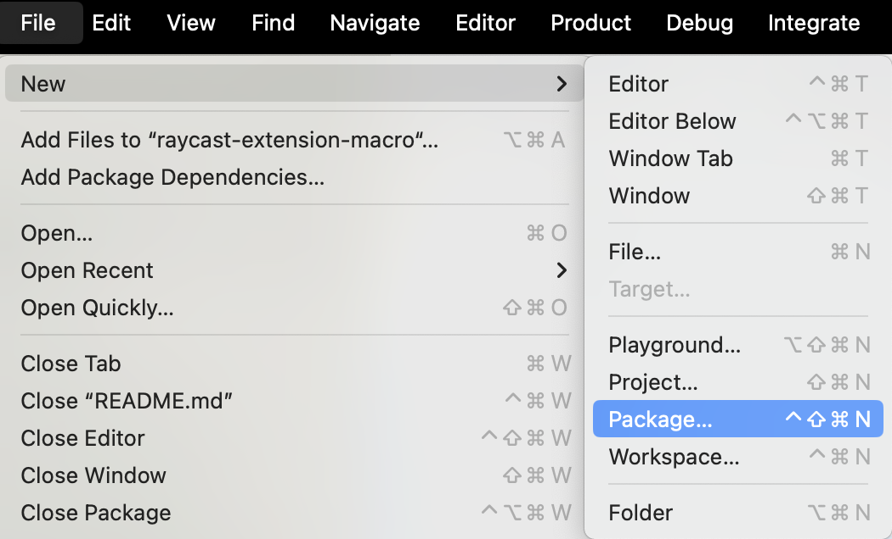
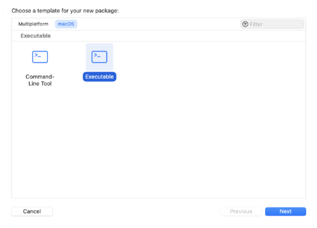

# Swift for Raycast Extensions

This Swift Package contains code generation macros and plugins to build a communication channel between [Raycast](https://raycast.com)'s React extensions and Swift native code. Basically, it lets you import Swift code into your Raycast extension in order to:
- leverage native macOS APIs that might not be exposed to TS/JS, or
- use Swift for targeted sections of your extension, letting you use all Swift language features (such as result builders, async/await, generics/existentials, etc.), or
- compartmentalize your extension into client-facing code (react) and system code (swift).

### Requirements

- Xcode 16.3 or later.

  Xcode needs to be installed in your system (version 16.3 or later, since the package requires the Swift 6 toolchain and depends on [swift-syntax](https://github.com/swiftlang/swift-syntax) 603). We are hoping to stop requiring Xcode in the future and just require the existence of a [Swift toolchain](https://www.swift.org/download/), alas we are not there yet. Please notice, you don't need to write the swift code in Xcode, you can use any other editor such as VSCode, Sublime, or Nova.


## Using the Package

We built a sample extension using Swift [here](https://github.com/raycast/extensions-swift-sample). Check it out to quickly get a feeling how things should be laid out.

To use Swift within Raycast:

1. Create (or fork) a Raycast extension.

    If you don't know how, check out [this guide](https://developers.raycast.com/basics/create-your-first-extension).

2. Create a Swift executable target in the folder of your Raycast extension.

   <p>You can create the target in any of the following ways:
   <details><summary>using Xcode, or</summary>
   <p></p>
   <ul>
   <li>Open Xcode</li>
   <li><code>File > New > Package...</code> to create a new Swift package</li>
   <li>Select <code>Executable</code></li>
   <li>Select the place within the Raycast extension package you want</li>
   <li>Untick the "Create Git repository on my Mac"
     <p>I like to put it in a <code>swift</code> folder next to the existing <code>src</code> folder.</p>
   </li>
   <li>Delete the <code>main.swift</code> file autogenerated by Xcode.
     <p>This file is reserved for the Raycast plugins generating the TypeScript interface.</p>
   </li>

    
    
   </p>
   </details>
   <details><summary>using the <code>swift package</code> command in the terminal or VSCode.</summary>
   <p></p>
   <ul>
   <li>Run <code>swift package init --type executable --name CustomName</code> in the Raycast extension folder.
   <p>In the previous command, <code>CustomName</code> references the name of the Swift Package. You can name this whatever you want.</p>
   </li>
   <li>Delete the <code>main.swift</code> file autogenerated by <code>swift package</code>.
     <p>This file is reserved for the Raycast plugins generating the TypeScript interface.</p>
   </li>
   </ul>
   </details>
   </p>

   > You shouldn't have a `main.swift` file in your project nor a structure marked with `@main`. These are reserved for the Swift-to-TypeScript plugins.

3. Modify the `Package.swift` file to include the necessary macros and build plugins.

    ```diff
    // swift-tools-version: 6.0

    import PackageDescription

    let package = Package(
        name: "CustomName",
    +    platforms: [
    +      .macOS(.v13)
    +    ],
    +    dependencies: [
    +      .package(url: "https://github.com/raycast/extensions-swift-tools", from: "1.1.0")
    +    ],
        targets: [
          .executableTarget(
            name: "CustomName",
    +       dependencies: [
    +         .product(name: "RaycastSwiftMacros", package: "extensions-swift-tools"),
    +         .product(name: "RaycastSwiftPlugin", package: "extensions-swift-tools"),
    +         .product(name: "RaycastTypeScriptPlugin", package: "extensions-swift-tools"),
    +       ]
          ),
        ]
    )
    ```

4. Import `RaycastSwiftMacros` in your Swift file.

   ```swift
   import RaycastSwiftMacros
   ```

5. Write global Swift functions and mark them with the `@raycast` attribute.

   Global functions marked with `@raycast` are exported to TypeScript. These functions can have any number of parameters, and one or no return type. Exported functions can also be asynchronous (`async`) or throw errors (`throws`). The only restrictions are:
   - Parameters must conform to `Decodable`.
   - The return type (if any) must conform to `Encodable` (or be `Void` or `()`).
   - Variadic parameters and parameter packs are not supported.
   - Only global functions will be exported. Methods or functions within `struct`s, `class`es, or `enum`s won't be exported.

   ```swift
   @raycast func greet(name: String, isFormal: Bool) -> String {
    let address = isFormal ? "Mr/Ms" : ""
    return "Hello \(address) \(name)! How are you?"
   }
   ```

   Custom types can be received as parameters or returned by the function. You just need to be sure the type conforms to `Decodable` (for arguments) and `Encodable` (for return types).

   ```swift
   @raycast func pickColor(name: String) throws -> Color {
     switch name {
     case "red": Color(red: 1, green: 0, blue: 0)
     case "green": Color(red: 0, green: 1, blue: 0)
     case "blue": Color(red: 0, green: 0, blue: 1)
     default: throw Color.Error.unsupportedColor
     }
   }

   struct Color: Encodable {
     let red: Float
     let green: Float
     let blue: Float

     enum Error: Swift.Error {
       case unsupportedColor
     }
   }
   ```

6. Import the exported functions in your TypeScript code with the `swift:` prefix.

   The path after `swift:` is relative to the importing file and points to the folder that holds `Package.swift`. For the layout above (a `swift` folder next to `src`):

   ```typescript
   import { greet } from "swift:../swift";

   const message = await greet("Ada", true);
   ```

   This import is what makes `ray build` and `ray develop` compile the Swift package. If no file imports the package with `swift:`, the build still succeeds, but it compiles no Swift and prints no "compiling swift package" step.

   Every exported function returns a `Promise` on the TypeScript side, including functions that are synchronous in Swift. A thrown Swift error rejects the promise.

   Compiling creates two folders that shouldn't be committed. Add them to your extension's `.gitignore`, as the [sample extension](https://github.com/raycast/extensions-swift-sample) does:

   ```gitignore
   .raycast-swift-build
   compiled_raycast_swift
   ```

## How the executable is called

The generated TypeScript wrappers run the compiled executable once per call. Knowing the format helps when you debug a function from Terminal:

- The first argument is the function's name.
- Each following argument is one parameter, JSON-encoded, in declaration order. A `String` parameter needs its JSON quotes.
- On success, the return value is printed to stdout as JSON, followed by a newline, and the process exits with code 0. A function without a return value prints only the newline, and its TypeScript wrapper resolves to `null`.
- The wrapper trims stdout, resolves to `null` if nothing remains, and otherwise parses it as one JSON value. Printing diagnostics from an exported function can therefore make the call fail or change its result; write them to stderr instead.
- On failure, the error is printed to stderr and the process exits with a non-zero code.

For `@raycast func greet(name: String, isFormal: Bool) -> String`:

```sh
<compiled executable> greet '"Ada"' 'true'
```

Synchronous functions run directly on the main thread; `async` functions run in a `Task`.

### Long-running functions

The generated wrapper resolves only when the process exits, so an exported function that never returns never resolves. If your extension needs Swift code that keeps running after the command ends, there is no supported API for it yet ([#14](https://github.com/raycast/extensions-swift-tools/issues/14)). A possible workaround, which you need to validate for your own use:

- Export a **synchronous** function that starts the run loop, for example with `NSApplication.shared.run()`, and never returns. AppKit's run loop must run on the main thread, and an `async` function runs in a `Task`, which doesn't guarantee that.
- Instead of calling its wrapper, start the compiled executable yourself with Node's `spawn`, passing the function name and JSON-encoded arguments as above, with `{ detached: true, stdio: "ignore" }`, then call `unref()`. Locate the executable under `environment.assetsPath` (currently `compiled_raycast_swift/<name of the folder holding Package.swift>`), never by a hard-coded absolute path, make sure it is executable (the generated runner calls `chmod 755` before each launch), and handle spawn errors.
- Talk to the running process from other, short-lived exported functions through some form of inter-process communication that you implement, for example `DistributedNotificationCenter`.
- If only one instance may run, give it an identity specific to your extension, such as an argument only your extension passes, and check it explicitly. The function name and arguments alone don't make a process unique: another extension can export a function with the same name.

This relies on details of the Raycast CLI that aren't a stable API: the executable's location and the argument format. Re-check them when you update `@raycast/api`.
